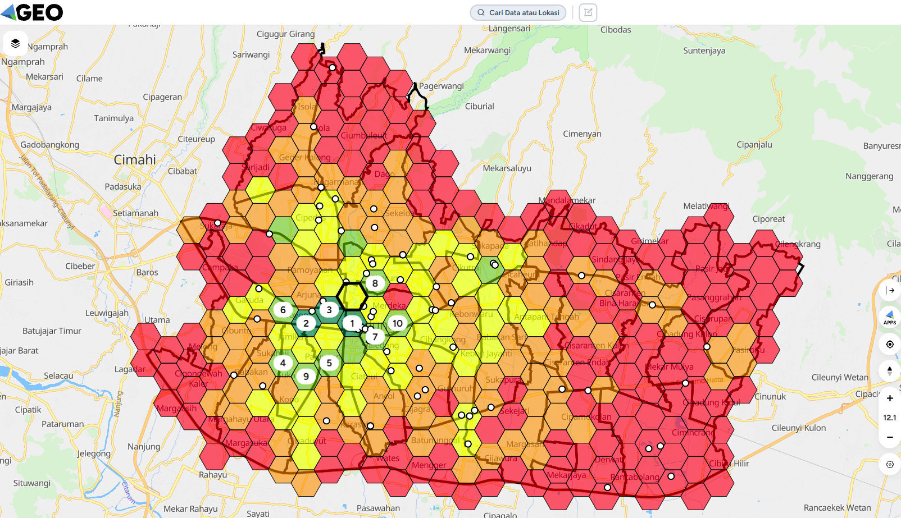
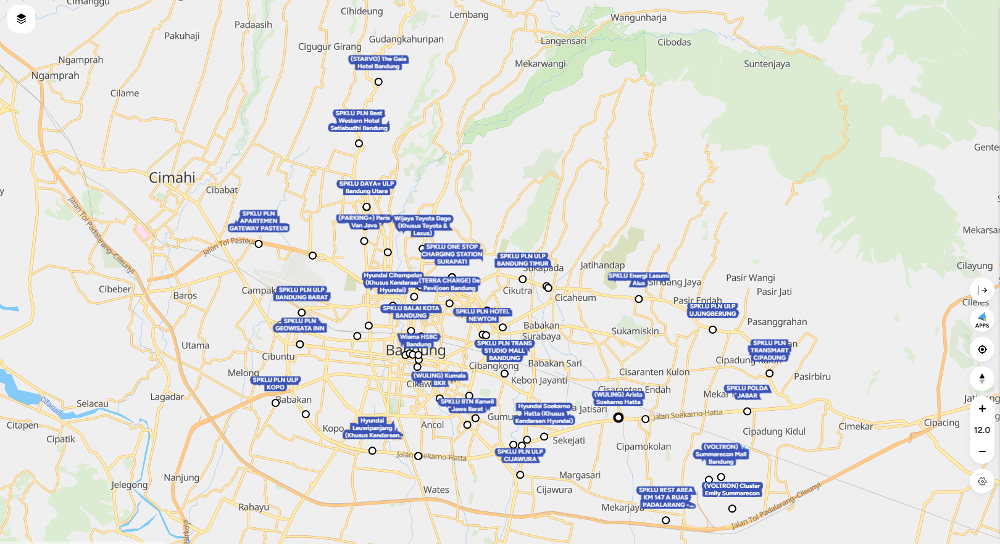
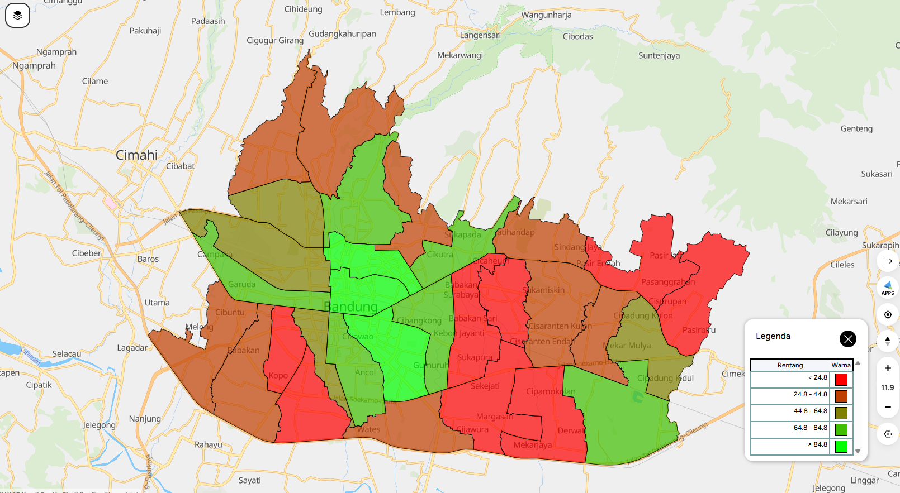
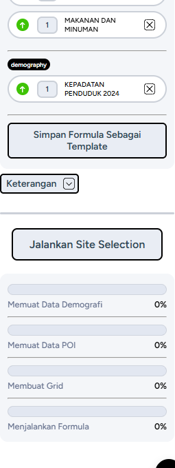
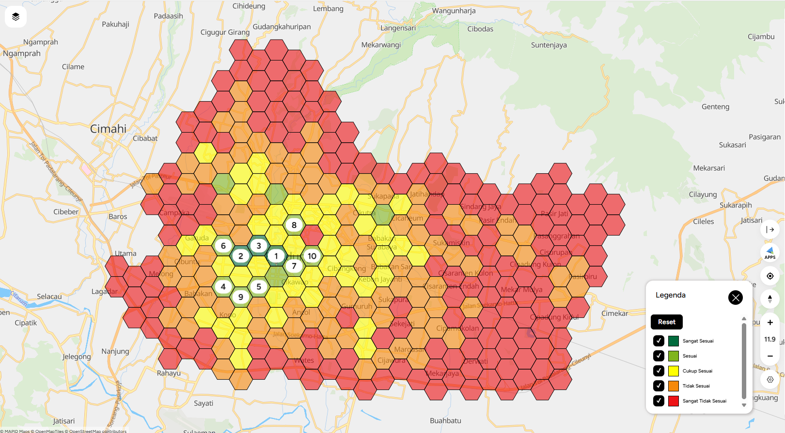
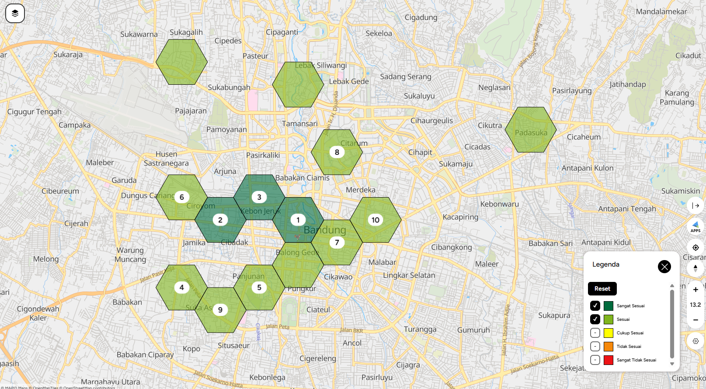

# Where should Bandung put its next EV charging station?

A site-selection analysis for public EV charging stations (*SPKLU, Stasiun Pengisian Kendaraan Listrik Umum*) in Kota Bandung, Indonesia, built with open data, Python and GEO MAPID.

**Recommendation:** Bojongloa Kaler district, around Jamika – Suka Asih. It is Bandung's most densely populated district (41,711 people/km²), it has no public charger, and it is the only area outside the city centre that ranks in GEO MAPID's top 10 suitability cells. Kiaracondong is the second priority.



## Why this question

- Indonesia had 4,778 public chargers at 3,093 locations in December 2025, against a target of about 192,000 by 2034 ([CNN Indonesia, 2026](https://cnnindonesia.com/otomotif/20260203162604-603-1324154/indonesia-punya-4778-spklu-saat-ini-ditargetkan-192-ribu-pada-2034)).
- Kota Bandung has 67 chargers (June 2026). 21 of them sit in just 3 of its 30 districts (Sumur Bandung, Bandung Wetan, Lengkong), the hotel and business core.
- 16 of the 67 are at car dealerships and are usually reserved for one brand, so only 51 serve the general public.



*Existing chargers cluster in the city centre and along Jl. Soekarno-Hatta. The south-west, between Kopo and the centre, is visibly empty.*

## Data

| Dataset | Use | Source | Licence / terms |
| --- | --- | --- | --- |
| Geocoded SPKLU stations, Indonesia (3,029 stations, retrieved 16 June 2026) | Charger locations, operator type | Wiputra, R. (2026). [Mendeley Data, DOI 10.17632/z2bvd5r574.1](https://data.mendeley.com/datasets/z2bvd5r574/1), from petaspklu.id / PT PLN | CC BY-NC 3.0 |
| Population and density by district, 2024 | Demand | [BPS Kota Bandung](https://bandungkota.bps.go.id/) | Public statistics, cite BPS |
| District (kecamatan) boundaries, 2020 | Spatial units | [Alf-Anas/batas-administrasi-indonesia](https://github.com/Alf-Anas/batas-administrasi-indonesia) | Check the source repo before reuse |
| Points of interest and grid-level population density | Suitability inputs | GEO MAPID demography and POI layers (accessed October 2026) | Follow GEO MAPID terms |
| Site Selection grid export (312 hexagon cells) | Suitability scores | Produced in GEO MAPID Site Selection | Follow GEO MAPID terms |

## Method

1. **Filter** the national charger dataset to Kota Bandung (67 stations) and drop records with flagged coordinates.
2. **Coverage gap:** buffer every *public* charger by 1 km and 2 km, then compute the share of each district's area inside that radius (straight-line distance, UTM 48S).
3. **Demand:** join 2024 BPS population and density per district.
4. **Suitability (GEO MAPID Site Selection):** hexagon grid scored on population density (weight 3) and five POI categories, all positive: retail & trade (2), transportation (2), hotels (1), health (1), food & beverage (1).
5. **Gap filter:** overlay existing chargers on the grid. High-scoring cells with no public charger nearby become candidate sites.
6. **Compare** four low-coverage candidate districts.

## Results

### 1. Coverage gap: where public chargers are missing

In 8 of 30 districts, less than 25% of the area is within 1 km of a public charger. They form a belt across the south-west, south and east of the city. The centre (Bandung Wetan, Sumur Bandung, Lengkong) is almost fully covered.



### 2. Suitability: GEO MAPID Site Selection

The city was split into 312 hexagon cells, each scored 0–100 with this formula (run on 27 October 2026):



Only 14 of 312 cells (4.5%) are *suitable* or *highly suitable*:

| Class | Cells |
| --- | --- |
| Highly suitable (Sangat Sesuai) | 3 |
| Suitable (Sesuai) | 11 |
| Moderately suitable (Cukup Sesuai) | 44 |
| Not suitable (Tidak Sesuai) | 93 |
| Highly unsuitable (Sangat Tidak Sesuai) | 161 |



Zoomed in on the 14 suitable cells (numbers are the top-10 ranks; the three unnumbered cells in the north are ranks 11–14):



| Rank | Score | Class | Area (from map labels) | Density (people/km²) | Total POI | Retail & trade POI |
| --- | --- | --- | --- | --- | --- | --- |
| 1 | 100.0 | Highly suitable | City centre (Alun-alun) | 15,053 | 657 | 562 |
| 2 | 91.9 | Highly suitable | Ciroyom – Cibadak | 68,753 | 329 | 265 |
| 3 | 91.2 | Highly suitable | Kebon Jeruk | 14,127 | 244 | 117 |
| **4** | **78.8** | Suitable | **Jamika (Jl. Peta / Jl. Pasirkoja), Bojongloa Kaler** | **68,753** | **211** | **172** |
| 5 | 74.7 | Suitable | Panjunan | 45,712 | 358 | 307 |
| 6 | 74.0 | Suitable | Ciroyom – Dungus Cariang | 55,113 | 204 | 176 |
| 7 | 73.0 | Suitable | Balong Gede | 15,053 | 215 | 109 |
| 8 | 70.6 | Suitable | Citarum | 1,769 | 308 | 169 |
| **9** | **70.4** | Suitable | **Suka Asih, Bojongloa Kaler** | **45,712** | **197** | **148** |
| 10 | 67.3 | Suitable | East of the centre (Merdeka – Kebonwaru) | 21,266 | 276 | 198 |

Density here is GEO MAPID's grid-level value, which can differ from the district averages published by BPS.

### 3. Gap filter: combining suitability with existing chargers

7 of the top 10 cells are in the city centre, which already has the most chargers. A suitability model alone would put new chargers where they are least needed. Overlaying existing chargers on the grid leaves cells 4 and 9 in Jamika – Suka Asih (Bojongloa Kaler) as the best high-scoring area with no public charger nearby (white dots on the map at the top of this page are existing chargers).

### 4. Candidate comparison

| District | Population | Density (people/km²) | Public chargers | Area within 1 km of a public charger | GEO MAPID grid |
| --- | --- | --- | --- | --- | --- |
| **Bojongloa Kaler** | 126,385 | 41,711 | 0 | 9.4% | Green, cells ranked 4 and 9 |
| Kiaracondong | 133,063 | 21,742 | 0 | 9.2% | Yellow (moderate) |
| Antapani | 82,350 | 21,728 | 0 | 4.8% | Yellow–orange |
| Cibiru | 79,452 | 12,572 | 1 | 21.0% | Orange–red |

**Bojongloa Kaler is recommended first**: the densest district in the city, no public charger, and the only area outside the centre in the top 10 suitability cells. **Kiaracondong is second**: more residents and no public charger, but only a moderate suitability score.

An interactive map of chargers and coverage is in [`docs/index.html`](docs/index.html) (publish it with GitHub Pages from the `docs/` folder).

## Limitations

- GEO MAPID's formula does not include existing chargers, so the gap filter was applied by overlay.
- POI weights add up to 7 against 3 for population, which tilts scores towards commercial areas.
- Coverage uses straight-line 1 km buffers and assumes population is spread evenly within each district.
- Data years differ: population 2024, chargers June 2026, boundaries 2020.
- EV ownership by district is not public, so population density stands in for demand.
- Grid cell locations are read from the GEO MAPID map labels; the export has no coordinates.

## Reproduce

The coverage-gap analysis can be fully rerun from open data:

```bash
pip install -r requirements.txt
python scripts/analysis.py
```

The suitability step (step 4) needs GEO MAPID, because its POI and grid population data are not open. Its exported results are included in `data/raw/geomapid_site_selection_grid.csv`, so the scores can still be checked.

```
data/raw/          input data (see table above)
data/processed/    Bandung chargers + districts with coverage and population (CSV, GeoJSON)
outputs/           summary_by_district.csv, candidate_comparison.csv, geomapid_grid_classes.csv
figures/           GEO MAPID maps and screenshots
result_selection/  GEO MAPID Site Selection maps (all cells, suitable cells zoomed)
docs/index.html    interactive map
scripts/analysis.py
```

## Credits

Analysis by Yana Wicaksana as part of the GEO MAPID *Spatial Data & Analysis Foundation* module (October 2026). Charger data © R. Wiputra / PT PLN (Persero) under CC BY-NC 3.0; population data © BPS Kota Bandung.
