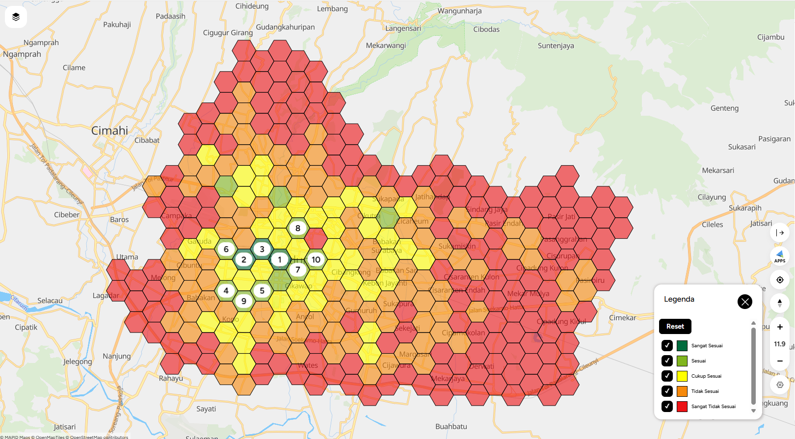
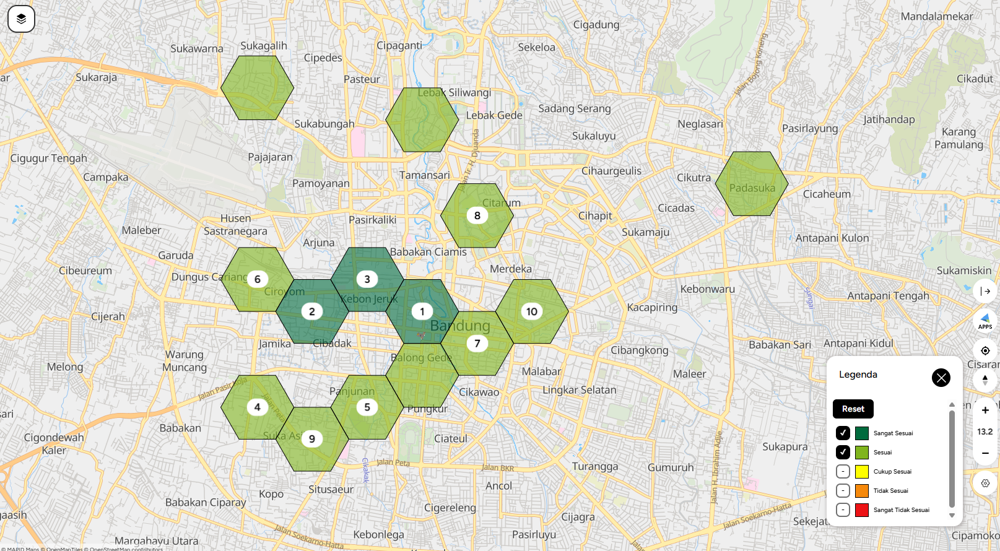

# Site Selection results (GEO MAPID)

GEO MAPID Site Selection output for Kota Bandung: 312 hexagon cells scored 0–100 on population density (weight 3) and five POI categories: retail & trade (2), transportation (2), hotels (1), health (1), food & beverage (1). Run on 27 October 2026.

## All cells by class

Only 14 of 312 cells (4.5%) are *suitable* or *highly suitable*. They cluster in the city centre and the south-west.

| Class | Cells |
| --- | --- |
| Highly suitable (Sangat Sesuai) | 3 |
| Suitable (Sesuai) | 11 |
| Moderately suitable (Cukup Sesuai) | 44 |
| Not suitable (Tidak Sesuai) | 93 |
| Highly unsuitable (Sangat Tidak Sesuai) | 161 |

## Suitable cells, zoomed in

Numbers are the rank of the top 10 cells. The three unnumbered cells in the north (Sukagalih, Lebak Siliwangi, Padasuka) are ranks 11–14.

| Rank | Score | Class | Area (from map labels) | Density (people/km²) | Total POI | Retail & trade POI |
| --- | --- | --- | --- | --- | --- | --- |
| 1 | 100.0 | Highly suitable | City centre (Alun-alun) | 15,053 | 657 | 562 |
| 2 | 91.9 | Highly suitable | Ciroyom – Cibadak | 68,753 | 329 | 265 |
| 3 | 91.2 | Highly suitable | Kebon Jeruk | 14,127 | 244 | 117 |
| **4** | **78.8** | Suitable | **Jamika (Jl. Peta / Jl. Pasirkoja), Bojongloa Kaler** | **68,753** | **211** | **172** |
| 5 | 74.7 | Suitable | Panjunan | 45,712 | 358 | 307 |
| 6 | 74.0 | Suitable | Ciroyom – Dungus Cariang | 55,113 | 204 | 176 |
| 7 | 73.0 | Suitable | Balong Gede | 15,053 | 215 | 109 |
| 8 | 70.6 | Suitable | Citarum | 1,769 | 308 | 169 |
| **9** | **70.4** | Suitable | **Suka Asih, Bojongloa Kaler** | **45,712** | **197** | **148** |
| 10 | 67.3 | Suitable | East of the centre (Merdeka – Kebonwaru) | 21,266 | 276 | 198 |

Density here is GEO MAPID's grid-level value, which can differ from the district averages published by BPS.

## How the result was used

The Site Selection formula does not know where chargers already are. Most of the top cells sit in the city centre, which already has the most public chargers (see `figures/02_geomapid_site_selection_grid.png`). Overlaying existing chargers leaves cells 4 and 9 in Jamika – Suka Asih (Bojongloa Kaler) as the best high-scoring area with no public charger nearby. That is the recommended location.

Areas are read from the map labels in GEO MAPID; the exported table (`data/raw/geomapid_site_selection_grid.csv`) has scores but no coordinates.
